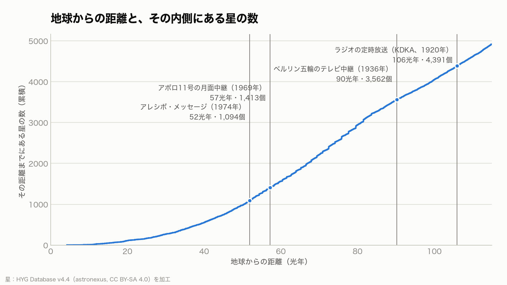
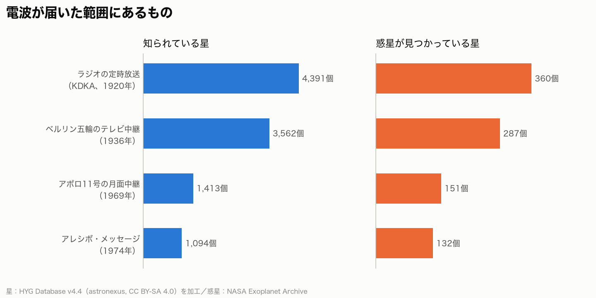
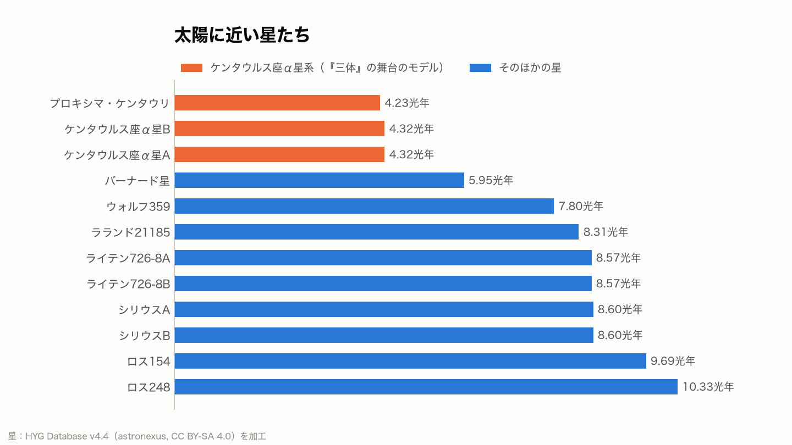

# 地球の電波は、どの星まで届いたか ―『三体』になぞらえて

SF 小説『三体』では、地球から出た電波が別の星系に届くところから物語が動き出します。現実の地球も、100 年ほど前からラジオやテレビの電波を宇宙に出し続けています。その電波がいまどこまで届いていて、そこにどんな星があるのかを、公開データで数えてみました。

基準日は 2026 年 10 月 11 日です。分析の進め方は [分析計画書](docs/analysis-plan.md) に、計算はすべて [src/](src/) にあります。

## 要点

- 1920 年に始まったラジオの定時放送の電波は、いま地球から約 **106 光年** の球の内側まで届いています。その中には、知られている星が **4,391 個**あり、そのうち **360 個** では惑星が見つかっています。
- 1969 年のアポロ 11 号の月面中継は約 57 光年先まで進み、1,413 個の星を通り過ぎました。
- 『三体』の舞台のモデルになったケンタウルス座α星系までは約 4.3 光年です。1974 年のアレシボ・メッセージ（約 52 光年先まで進んでいる）なら、この星系と地球の間を **6 往復** できるほどの時間がたっています。

## Q-01 地球の電波は、いまどこまで届いていて、その中に星はいくつあるか

<picture>
  <source media="(prefers-color-scheme: dark)" srcset="figures/o01-cumulative-stars-dark.png">
  
</picture>

電波は光と同じ速さで進むので、出来事の日から基準日までの年数が、そのまま「届いた半径（光年）」になります。

| 出来事 | 届いた半径 | 範囲内の知られている星 | 惑星が見つかっている星 |
| --- | --- | --- | --- |
| ラジオの定時放送（KDKA、1920年） | 106 光年 | 4,391 個 | 360 個（惑星 595 個） |
| ベルリン五輪のテレビ中継（1936年） | 90 光年 | 3,562 個 | 287 個（惑星 489 個） |
| アポロ11号の月面中継（1969年） | 57 光年 | 1,413 個 | 151 個（惑星 272 個） |
| アレシボ・メッセージ（1974年） | 52 光年 | 1,094 個 | 132 個（惑星 238 個） |

- 半径が 2 倍になると、球の体積は 8 倍になります。そのため、届いた範囲が広がるほど、内側にある星の数は急に増えていきます。

## Q-02 電波が届いた範囲に、惑星が見つかっている星はいくつあるか

<picture>
  <source media="(prefers-color-scheme: dark)" srcset="figures/o02-by-event-dark.png">
  
</picture>

- ベルリン五輪のテレビ中継（約 90 光年）の範囲だけでも、惑星が見つかっている星が 287 個、惑星が 489 個あります。

## Q-03 『三体』の舞台のモデル、ケンタウルス座α星系

<picture>
  <source media="(prefers-color-scheme: dark)" srcset="figures/o03-nearest-stars-dark.png">
  
</picture>

ケンタウルス座α星系は、太陽に一番近い恒星系です。3 つの星からなり、小説の「三体」のモデルになりました。

| 星 | スペクトル型 | 距離 | 明るさ（太陽＝1） |
| --- | --- | --- | --- |
| 太陽 | G2V | 0.00 光年 | 1.00 |
| ケンタウルス座α星A | G2V | 4.32 光年 | 1.54 |
| ケンタウルス座α星B | K1V | 4.32 光年 | 0.44 |
| プロキシマ・ケンタウリ | M5Ve | 4.23 光年 | 約 17,331 分の 1 |

- α星 A は太陽とよく似た星（スペクトル型 G2）で、明るさは太陽の約 1.5 倍です。
- プロキシマ・ケンタウリは小さな赤色矮星で、明るさは太陽の約 17,331 分の 1 しかありません。

プロキシマ・ケンタウリには、惑星が見つかっています。

| 惑星 | 質量 | 公転周期 | 恒星からの距離 | 発見 |
| --- | --- | --- | --- | --- |
| Proxima Cen b | 地球の約 1.05 倍 | 11.2 日 | 0.048 天文単位 | 2016 年（視線速度法） |
| Proxima Cen d | 地球の約 0.26 倍 | 5.1 日 | 0.029 天文単位 | 2025 年（視線速度法） |

- プロキシマ b は、地球と同じくらいの質量の惑星が 11.2 日で恒星の周りを回っています。質量は、恒星のふらつきから求めた推定値です。

## このデータの限界

- **星の数は「知られている星」の数です。** HYG Database は明るい星と、よく知られた近くの星を網羅していますが、暗い赤色矮星や褐色矮星の多くは入っていません。実際の星の数は、これより多くなります。
- **「届いた」は、光の速さで計算した理論上の範囲です。** 遠くに届いた電波はとても弱くなるので、受信できる強さかどうかは、この分析では扱っていません。
- 星の距離はカタログの値で、誤差があります。範囲の境目にある星は、数に入るかどうかが変わることがあります。

## 再現の手順

```sh
uv sync
uv run space-analysis     # 検証 → 集計 → 図と表 → このレポート
uv run pytest
```

---

- 星：HYG Database v4.4（astronexus, CC BY-SA 4.0）を加工。加工したデータ（`data/`）と図（`figures/`）も CC BY-SA 4.0 です。
- This research has made use of the NASA Exoplanet Archive, which is operated by the California Institute of Technology, under contract with the National Aeronautics and Space Administration under the Exoplanet Exploration Program.（Christiansen et al. 2025, Planetary Science Journal, doi:10.3847/PSJ/ade3c2）
- 小説『三体』（劉慈欣）の本文や画像は使っていません。
